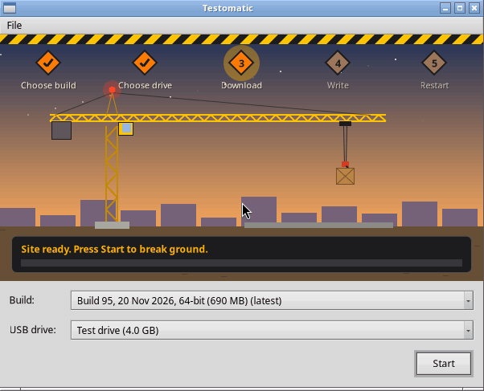
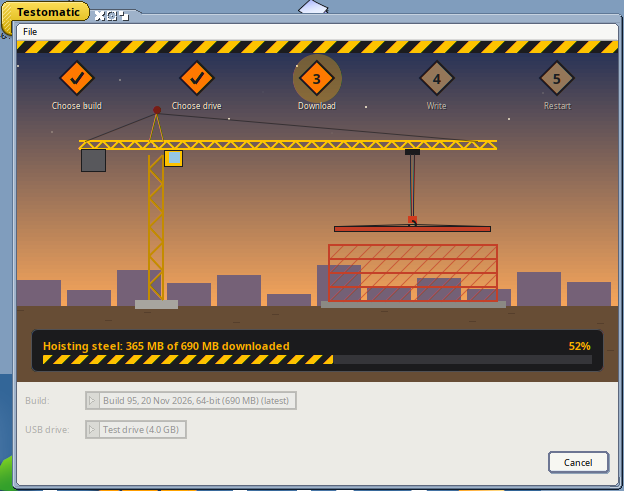
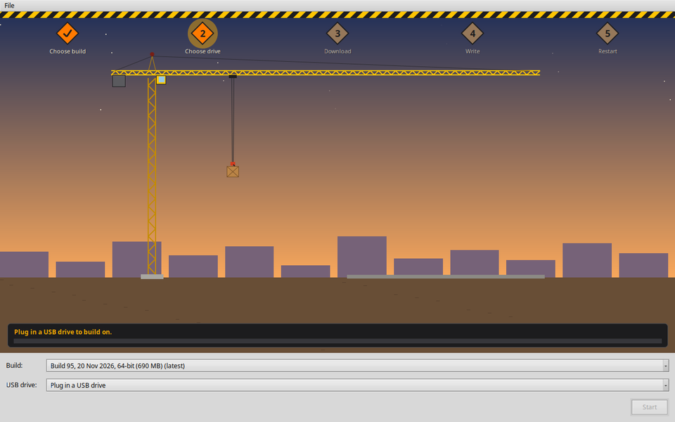

# Testomatic

Try RenkuOS from a USB drive. Testomatic lists the RenkuOS builds published on GitHub
(the latest is picked for you), downloads one and checks its SHA-256, or takes an image
file you already have (File ▸ Open image…, the "Image file…" item in the Build menu, or
drop an ISO on the window). Then it writes the image to the USB drive you choose and
offers to restart the computer.

The job plays out on a construction site: road signs for the steps, a crane that hoists
steel while the image downloads and pours concrete floors while it is written, and a
message board with a hazard-striped progress bar.

Native Haiku API, one source tree for Renku OS (`.hpkg`) and Linux through Hokku (AppImage).

## Building

    make            # on Renku/Haiku, or on Linux with Hokku (COSMOE_ROOT=/usr)
    make test       # portable core: release parsing, lsblk, dd progress

## How it works

| | Renku / Haiku | Linux |
|---|---|---|
| Builds | GitHub releases API of RenkuOS/Source, via `curl` | same |
| Drives | `/dev/disk/usb/*/0/raw`, not the boot disk | `lsblk`, USB disks that don't hold `/`, `/boot`, `/home`, swap |
| Writing | unmounts the drive's volumes, then `dd` | `pkexec` unmounts and runs `dd` |
| Restart | `shutdown -r` | `systemctl reboot` |
| Downloads kept in | `~/config/cache/Testomatic` | `~/.cache/cosmoe/Testomatic` |

Only the latest download is kept; starting a different build deletes the older one.

## Screenshots

Haiku R1/beta6: hoisting steel while build 95 downloads.

Linux (the AppImage under Wayland, from CI): the latest build picked, waiting for a USB drive.

## Status

| Check | Renku/Haiku | Linux |
|---|---|---|
| Download, checksum, write | ran on Haiku R1/beta6 x86_64 (QEMU): build 95 downloaded, verified, written to a test drive file byte for byte; arm64: Renku's arm64 image in QEMU | ran under X11 (Xvfb): the same; the CI AppImages start under X11 and Wayland on x86_64 and arm64 |
| Writing to a real USB drive | not tested | not tested (pkexec path) |
| Restart | not tested | not tested |
| Renku OS x86_64 | not tested (the package is built on Haiku R1/beta6, which Renku installs) | |

## Licence

MIT
